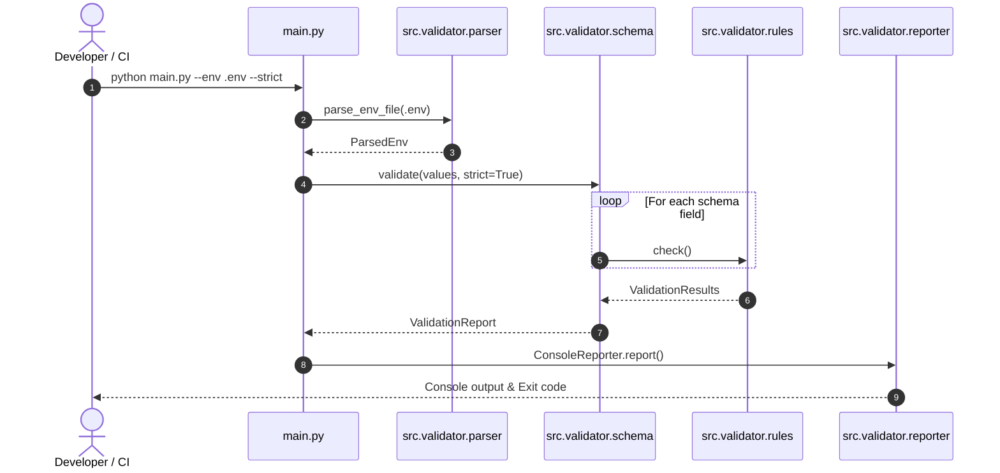

# ⚙️ env-validator-cli

<p align="left">
  <a href="https://github.com/bighnaraj2008-ai/env-validator-cli/actions/workflows/validator_ci.yml"></a>
  <a href="docs/TEST_COVERAGE.md"></a>
  <a href="https://www.python.org/"></a>
  <a href="LICENSE"></a>
  <a href="https://flake8.pycqa.org/"></a>
</p>

> **Industry-grade, zero-dependency CLI tool to validate, cast, and synchronize `.env` configurations against strict schemas and `.env.example` templates.**

---

## Overview

In modern cloud-native and 12-factor application architectures, environment variables
drive configuration across environments (Local, Staging, Production). A frequent source
of runtime crashes and deployment failures is **configuration drift**—missing keys,
malformed URLs, invalid integer ports, or short signing secrets.

`env-validator-cli` catches misconfigurations before boot by validating every `.env`
variable against strict type, regex, length, and required rules.

---

## Modular Architecture



See [`docs/ARCHITECTURE.mmd`](docs/ARCHITECTURE.mmd) for complete architecture diagrams and component matrices.

For documentation and specifications, see [`docs/SCHEMA_AUTHORING.md`](docs/SCHEMA_AUTHORING.md) and [`docs/SCHEMA_GUIDE.md`](docs/SCHEMA_GUIDE.md), [`docs/ARCHITECTURE_REFACTOR.md`](docs/ARCHITECTURE_REFACTOR.md), [`docs/TEST_COVERAGE.md`](docs/TEST_COVERAGE.md), [`docs/EDGE_CASES.md`](docs/EDGE_CASES.md), [`docs/FIXTURE_GUIDE.md`](docs/FIXTURE_GUIDE.md), [`docs/BENCHMARK_TEMPLATE.md`](docs/BENCHMARK_TEMPLATE.md).


---

## Quickstart Guide

### 1. Installation

```bash
git clone https://github.com/bighnaraj2008-ai/env-validator-cli.git
cd env-validator-cli
python -m pip install -e ".[dev]"
```

*(Because the core engine uses only Python's standard library, `python main.py` also runs directly without external installs.)*

### 2. Validate Environment Files

```bash
# Strict schema validation against an example file
python main.py --env .env.example

# Strict hygiene mode (fails on undeclared extra keys)
python main.py --env .env.example --strict

# Machine-readable JSON output for CI/CD gates
python main.py --env .env.example --format json

# Legacy key-sync check against .env.example
python main.py --env .env.example --compare-example
```

### 3. Run Unit Tests & Linters

```bash
pytest tests/ -v
flake8 main.py src schemas tests scripts
```

---

## Testing & Quality Assurance

Run the test suite and edge-case validation suite locally:

```bash
# Run full pytest suite
pytest tests/ -v

# Run automated test harness with fixture ingestion and diagnostics
python scripts/run_unit_tests.py

# Run pre-flight integration smoke tests
bash scripts/smoke_test.sh
```

---

## Troubleshooting

- **`EnvFileNotFoundError`:** Ensure `--env` points to an existing file (default is `.env`; pass `--env .env.example` in CI).
- **Unexpected extra keys in `--strict` mode:** Add newly introduced keys to `schemas/env_schema.py` or `schemas/env_schema.yaml`.
- **`TypeCastError` on booleans:** Accepted truthy/falsy strings are `1/0`, `true/false`, `yes/no`, and `on/off` (case-insensitive).
- **Fixture validation errors:** Ensure files in `tests/fixtures/` retain exact character encodings (UTF-8 without BOM). Run `python scripts/validate_fixtures.py` to check SHA-256 integrity.
- **Pytest collection warnings:** Ensure the local test environment has `pytest` and `pyyaml` installed (`pip install -e ".[dev]"`).

---

## Contributing & Security

See [`CONTRIBUTING.md`](CONTRIBUTING.md) for development guidelines, testing standards, and [`SECURITY.md`](SECURITY.md) for responsible disclosure.
When contributing new validation rules, ensure matching test cases are added to `tests/edge_cases/` and documented in `docs/EDGE_CASES.md`.

---

## License

Licensed under the MIT License (Open Source) — see [`LICENSE`](LICENSE) for complete copyright terms.

---

<!-- Project 3 (env-validator-cli) Day 2 Test Coverage & Fixture Improvements Sprint Completed -->
