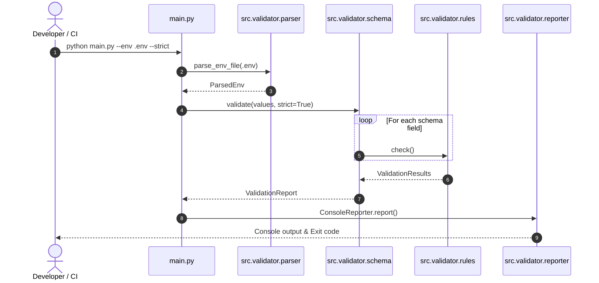

# ⚙️ env-validator-cli

<p align="left">
  <a href="https://github.com/bighnaraj2008-ai/env-validator-cli/actions/workflows/ci_validation.yml"></a>
  <a href="https://github.com/bighnaraj2008-ai/env-validator-cli/actions/workflows/validator_ci.yml"></a>
  <a href="docs/TEST_COVERAGE.md"></a>
  <a href="CHANGELOG.md"></a>
  <a href="#"></a>
  <a href="https://www.python.org/"></a>
  <a href="LICENSE"></a>
  <a href="https://flake8.pycqa.org/"></a>
</p>

> **Industry-grade, zero-dependency CLI tool to validate, cast, and synchronize `.env` configurations against strict schemas and `.env.example` templates.**

---

## Overview

In modern cloud-native and 12-factor application architectures, environment variables
drive configuration across environments (Local, Staging, Production). A frequent source
of runtime crashes and deployment failures is **configuration drift** - missing keys,
malformed URLs, invalid integer ports, or short signing secrets.

`env-validator-cli` catches misconfigurations before boot by validating every `.env`
variable against strict type, regex, length, and required rules.

---

## Table of Contents

1. [Quickstart](#quickstart-guide)
2. [Modular Architecture](#modular-architecture)
3. [Schema Authoring](#schema-authoring)
4. [Command-Line Usage](#command-line-usage)
5. [Testing & Quality Assurance](#testing--quality-assurance)
6. [Troubleshooting](#troubleshooting)
7. [Documentation Index](#documentation-index)
8. [Contributing & Security](#contributing--security)
9. [License](#license)

---

## Modular Architecture



See [`docs/ARCHITECTURE.mmd`](docs/ARCHITECTURE.mmd) for complete architecture diagrams and component matrices.

For documentation and specifications, see [`docs/SCHEMA_AUTHORING.md`](docs/SCHEMA_AUTHORING.md) and [`docs/SCHEMA_GUIDE.md`](docs/SCHEMA_GUIDE.md), [`docs/ARCHITECTURE_REFACTOR.md`](docs/ARCHITECTURE_REFACTOR.md), [`docs/TEST_COVERAGE.md`](docs/TEST_COVERAGE.md), [`docs/EDGE_CASES.md`](docs/EDGE_CASES.md), [`docs/FIXTURE_GUIDE.md`](docs/FIXTURE_GUIDE.md), [`docs/BENCHMARK_TEMPLATE.md`](docs/BENCHMARK_TEMPLATE.md), and [`docs/CI_CD_PIPELINE.md`](docs/CI_CD_PIPELINE.md).

For comprehensive CLI flag references and exit codes, see [`docs/CLI_USAGE.md`](docs/CLI_USAGE.md).
For Python programmatic integration, consult the [`docs/API_REFERENCE.md`](docs/API_REFERENCE.md).
Upgrading from older schema contracts? Follow the [`docs/MIGRATION_V2.md`](docs/MIGRATION_V2.md) migration guide.
For SOC2 / enterprise configuration compliance policies, review [`docs/ENV_GOVERNANCE.md`](docs/ENV_GOVERNANCE.md).

---

## Quickstart Guide

### 1. Installation

```bash
git clone https://github.com/bighnaraj2008-ai/env-validator-cli.git
cd env-validator-cli
python -m pip install -e ".[dev]"
```

*(Because the core engine uses only Python's standard library, `python main.py` also runs directly without external installs.)*

### 2. Validate Environment Files

```bash
# Strict schema validation against an example file
python main.py --env .env.example

# Strict hygiene mode (fails on undeclared extra keys)
python main.py --env .env.example --strict

# Machine-readable JSON output for CI/CD gates
python main.py --env .env.example --format json

# Legacy key-sync check against .env.example
python main.py --env .env.example --compare-example
```

### 3. Run Unit Tests & Linters

```bash
pytest tests/ -v
flake8 main.py src schemas tests scripts
python -m black --check --diff main.py src schemas tests scripts
```

For comprehensive linter rules and formatting specifications, see [`docs/LINTER_STANDARDS.md`](docs/LINTER_STANDARDS.md).

---

## Testing & Quality Assurance

Run the test suite and edge-case validation suite locally:

```bash
# Run full pytest suite
pytest tests/ -v

# Run automated test harness with fixture ingestion and diagnostics
python scripts/run_unit_tests.py

# Run pre-flight integration smoke tests
bash scripts/smoke_test.sh
```

---

## CI/CD Pipeline

Automated build, test, static analysis, and release workflows run on GitHub Actions:

| Workflow | Trigger | Purpose |
|:---------|:--------|:--------|
| `ci_validation.yml` | push / PR to `main` | Build + test + lint across Python 3.9-3.12 |
| `python_lint.yml` | PR to `main` | flake8 + black static analysis |
| `release_package.yml` | push tag `v*` | Build wheel/sdist and publish to PyPI |
| `test_coverage.yml` | push / PR to `main` | Coverage & performance profiling |
| `docs_check.yml` | push / PR to `main` | Markdown link & syntax verification |

The build matrix covers Python 3.9-3.12 on `ubuntu-latest`. Linting is
enforced with flake8 (`.flake8`) and black (`[tool.black]` in `pyproject.toml`).
Releases are published from version tags (`v*`).

See [`docs/CI_CD_PIPELINE.md`](docs/CI_CD_PIPELINE.md) for the complete pipeline
architecture, linting standards, build matrix, and local reproduction steps.

---

## Troubleshooting

- **`EnvFileNotFoundError`:** Ensure `--env` points to an existing file (default is `.env`; pass `--env .env.example` in CI).
- **Unexpected extra keys in `--strict` mode:** Add newly introduced keys to `schemas/env_schema.py` or `schemas/env_schema.yaml`.
- **`TypeCastError` on booleans:** Accepted truthy/falsy strings are `1/0`, `true/false`, `yes/no`, and `on/off` (case-insensitive).
- **Fixture validation errors:** Ensure files in `tests/fixtures/` retain exact character encodings (UTF-8 without BOM). Run `python scripts/validate_fixtures.py` to check SHA-256 integrity.
- **Pytest collection warnings:** Ensure the local test environment has `pytest` and `pyyaml` installed (`pip install -e ".[dev]"`).
- **Diagnostic Playbook:** For in-depth error triage playbooks, see [`docs/DIAGNOSTICS.md`](docs/DIAGNOSTICS.md) and [`docs/INCIDENT_PLAYBOOK.md`](docs/INCIDENT_PLAYBOOK.md).
- **CI/CD Build Failures:** Consult [`docs/TROUBLESHOOTING_CI.md`](docs/TROUBLESHOOTING_CI.md) for diagnostics and fixes across the Python build matrix.

---

## Contributing & Security

See [`CONTRIBUTING.md`](CONTRIBUTING.md) for development guidelines, testing standards, [`SECURITY.md`](SECURITY.md) for responsible disclosure, and [`docs/SECURITY_POLICY.md`](docs/SECURITY_POLICY.md) for policy details.
When contributing new validation rules, ensure matching test cases are added to `tests/edge_cases/` and documented in `docs/EDGE_CASES.md`.
For custom validation rule contribution instructions, see [`docs/CONTRIBUTORS_GUIDE.md`](docs/CONTRIBUTORS_GUIDE.md).
Please verify all pull requests pass `flake8` and `python scripts/validate_docs.py` before submitting.

---

## License

Licensed under the [MIT License](LICENSE) (Open Source). Copyright (c) 2026 bighnaraj2008-ai.

---

## Documentation Index

| Guide / Runbook | Description |
|---|---|
| [`docs/SCHEMA_AUTHORING.md`](docs/SCHEMA_AUTHORING.md) | Declarative YAML schema specification and constraint rules |
| [`docs/CLI_USAGE.md`](docs/CLI_USAGE.md) | CLI arguments, strict flags, JSON formats, and exit codes |
| [`docs/ARCHITECTURE.mmd`](docs/ARCHITECTURE.mmd) | Sequence and component architecture diagrams |
| [`docs/API_REFERENCE.md`](docs/API_REFERENCE.md) | Python API reference for parser and schema engine |
| [`docs/DEPLOYMENT_GUIDE.md`](docs/DEPLOYMENT_GUIDE.md) | Production CI/CD pipelines (GitHub Actions, Docker, K8s) |
| [`docs/DIAGNOSTICS.md`](docs/DIAGNOSTICS.md) | Configuration anomaly diagnostic playbook |
| [`docs/SECURITY_HARDENING.md`](docs/SECURITY_HARDENING.md) | Secret hygiene and leakage prevention protocols |
| [`docs/CONTRIBUTORS_GUIDE.md`](docs/CONTRIBUTORS_GUIDE.md) | Custom rule authoring and test standards |
| [`docs/ENV_GOVERNANCE.md`](docs/ENV_GOVERNANCE.md) | SOC2 / ISO 27001 configuration compliance |
| [`docs/MIGRATION_V2.md`](docs/MIGRATION_V2.md) | Schema version migration guidelines |
| [`docs/CI_CD_PIPELINE.md`](docs/CI_CD_PIPELINE.md) | CI/CD automation pipeline and build matrix specifications |
| [`docs/LINTER_STANDARDS.md`](docs/LINTER_STANDARDS.md) | Python coding standards and linter rule configuration |
| [`docs/TROUBLESHOOTING_CI.md`](docs/TROUBLESHOOTING_CI.md) | Triage and resolutions for failing CI/CD validation builds |
| [`docs/RELEASE_PROCESS.md`](docs/RELEASE_PROCESS.md) | Version bumping, tag publishing, and wheel packaging runbook |
| [`docs/SECURITY_POLICY.md`](docs/SECURITY_POLICY.md) | Security reporting and vulnerability disclosure policy |
| [`docs/FAQ_AUTOMATION.md`](docs/FAQ_AUTOMATION.md) | Frequently asked questions for CI/CD and automation |

---

<!-- Project 3 (env-validator-cli) Day 3 Advanced Documentation Sprint Completed -->
